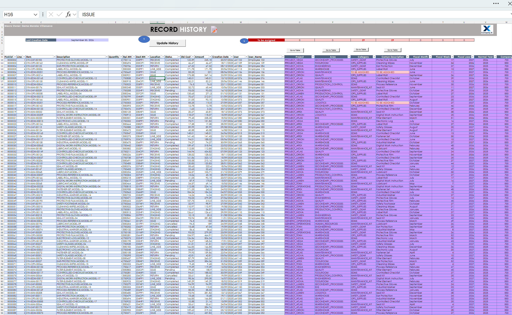
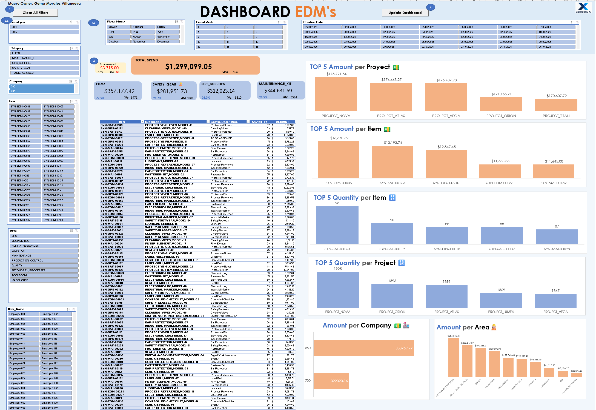

# EDMS Reporting Automation

### Excel VBA | SQL Server | Data Analytics

## Project Overview

This project automated a weekly reporting process that previously required downloading, consolidating, and analyzing three separate ERP reports.

The original solution integrated **Microsoft SQL Server, stored procedures, and Excel VBA** to retrieve one year of historical data and refresh interactive dashboards with a single click.

## Results

| Metric | Before | After |
|---|---|---|
| Reporting time | ~4 hours | ~2 minutes |
| Data preparation | Manual | Automated |
| Historical analysis | Limited | 1 year |

**99.17% reduction in reporting time**, significantly improving reporting efficiency and reducing repetitive tasks.

## Technologies

- **Microsoft SQL Server:** Data retrieval and consolidation through stored procedures.
- **Excel VBA:** Automated data and dashboard refresh.
- **Excel:** PivotTables, PivotCharts, slicers, and interactive dashboards.

## Dashboard Preview

### Historical Data

Consolidated historical records used for reporting and analysis, including project information, categories, quantities, costs, and fiscal periods.

### Interactive Dashboard

Interactive Excel dashboard featuring spending analysis, KPIs, and visualizations with filters by project, category, area, and fiscal period.

## Public Version & Confidentiality

This repository contains a demonstration version with synthetic data.

For confidentiality reasons, the original **SQL Server connection, stored procedure, and corporate information have been removed**.

The dashboard and interactive filters remain available, but the **data refresh button is nonfunctional** in this public version.

The original automation and its performance results are described for portfolio purposes.
